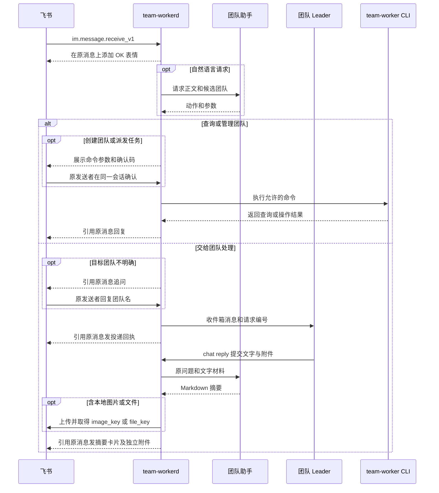

# 飞书接入调用流程

`team-workerd` 内置飞书接入。它接收机器人事件，把请求交给目标团队的 Leader，再把进展和结果回复到原消息。操作示例见 [飞书消息工作流](feishu-messaging-spec.md)，配置和 API 字段见 [CLI 和服务接口参考](reference.md#飞书自建应用)。

## 应用连接

1. 管理员在看板的 **Settings → Feishu integration** 保存 App ID 和 App Secret。看板经 `PUT /api/chat/feishu/app` 调用 daemon，将凭据写入数据目录的 `feishu.json`，文件权限为 `0600`。启动时提供的 `FEISHU_APP_ID` 和 `FEISHU_APP_SECRET` 优先。
2. daemon 每 3 秒检查应用配置。应用凭据发生变化时，它停止旧连接，再用新凭据启动飞书 SDK。SDK 先用租户访问令牌调用 `GET /open-apis/bot/v3/info` 取得机器人的 `open_id`，随后通过长连接监听 `im.message.receive_v1`。
3. 管理员保存当前应用下有权发指令的用户 `open_id`。这项授权覆盖现有和新建团队。清空时暂停收件。尚未启用全局授权的旧部署按团队接收开关和发送者名单检查权限。

## 入站消息与团队路由

daemon 只接收当前应用的用户文本事件。群聊的首次请求须在飞书里实际 @机器人，daemon 按事件中的提及对象 ID 判断。入站请求保存应用、原消息 ID、发送者、会话和是否来自话题。应用和原消息 ID 共同用于生成请求编号，飞书重推同一事件时沿用该编号。

收到授权用户发给机器人的文本后，daemon 在原消息上添加飞书 OK 表情。应用如缺少表情回复权限，可申请 `im:message.reactions:write_only`。调用失败或超时会记日志，正文照常处理。 [飞书表情回复 API](https://open.feishu.cn/document/server-docs/im-v1/message-reaction/create)

| 输入 | daemon 的处理 |
| --- | --- |
| `/tw send <团队> <正文>` 且团队在候选名单里 | 直接标记为待投递，跳过路由 Agent |
| 自然语言请求 | 把正文和有权访问的团队名或别名交给团队助手。查询和管理操作走本地 CLI。需要交给团队处理的请求进入待投递 |
| 路由 Agent 无法选定团队 | 引用原消息追问。群聊要引用追问回复团队名。私聊只有一条待确认请求时，可直接回复团队名。确认后继续投递原请求 |

daemon 投递时再次检查权限，在同一事务写入当前 Leader 的收件箱、更新请求状态并排队发送回执。路由或摘要各自排队满 2 分钟时会提示一次。等待路由、等用户确认或待投递的请求从创建起满 24 小时后过期。

### 团队助手的调用

| 用途 | 输入 | 结果 |
| --- | --- | --- |
| 判断请求意图 | 请求正文、允许访问的候选名单 | 结构化的 `action` 和参数。对于已有团队，`alias` 只能从候选名单中选择 |
| 整理答复 | 原问题、本次提交的文字材料 | 结构化的 `summary` |

配置了专用 Codex 目录时，daemon 为每次调用启动本地 `codex app-server`。普通对话首次调用 `thread/start` 保存线程，后续通过 `thread/resume` 续接。每个应用、发送者和会话或话题各有自己的线程。聊天设置修改后开启新线程，按新权限取数据。重启后通过 SQLite 中的映射找到专用 Codex 目录下的历史。后台结果摘要仍用独立的临时线程。

全局授权账号可以在飞书里向 Codex 提问，也可以请它直接读文档、写草稿或处理工作区文件。Codex 使用专用配置启用的 Skill、MCP、插件和其他工具，工作目录是专用 Codex 目录下的 `workspace`。涉及团队时，它也可通过 daemon 的 Unix socket 调用本地 `team-worker` CLI。直接答复保留 Markdown 格式并省略卡片标题。旧版按团队授权的账号继续通过 daemon 查询授权范围内的数据。消息分类和后台摘要使用已有材料。若工具请求交互审批或输入，飞书会告知用户。内置的建队和派活仍使用确认码。

其余部署可用 `LLM_API_BASE` 与 `TEAM_WORKER_FEISHU_ROUTER_MODEL` 走兼容网关的 `POST /chat/completions`，每次只传当前请求。助手暂时不可用时，明确指定团队的消息仍可进入 Leader 收件箱，待路由和待摘要任务留在队列中。 [路由模型配置](reference.md#飞书自建应用)

## 团队助手查询与确认

团队助手识别「现在有几个团队」等查询后，daemon 调用同机 `team-worker` CLI，通过当前 daemon 的 Unix socket 读取数据。回复只列出发起人有权访问的信息。团队、成员和任务列表显示总数及前 20 项。直接问指定团队的状态时，daemon 从 `board show` 生成回复，列出进程在线数、任务执行状态和检查点。已确认的检查点会标明结果仍待提交，时间统一用 UTC。

创建团队和派发任务只对全局授权的飞书账号开放。daemon 先保存待确认操作，再把具体参数发到原会话。同一发送者在原会话回复 `/tw confirm <确认码>` 才会消费该确认码。确认码 10 分钟有效，群聊确认须 @机器人。执行前再次检查权限，任务负责人必须是当前团队成员。执行中断后，队列保留结果未知的状态，避免自动执行两次。

CLI 子命令由 daemon 根据已校验的动作选择。Codex 用嵌入的团队助手提示词理解飞书消息。普通问题可直接回答。问到指定团队时，助手可参考看板摘要和近期结果。提示词包含从 teamworker 技能和 Agent 启动提示提炼的命令用法。 [提示词](../internal/chat/team-assistant-prompt.md) · [CLI 技能](../skills/teamworker/SKILL.md)

## Leader 回复与飞书 API

1. Leader 执行 `team-worker chat reply <团队> <请求编号> <材料>`。CLI 读取本地附件，经 Unix socket 调用 `POST /v1/teams/{team}/chat/requests/{id}/results`。群聊需带 `--group-approved`。
2. daemon 验证请求所属团队、当前 Leader 的运行实例和原发送者权限。同一请求下，类型、正文和附件都相同的重复提交共用一条结果任务。`--progress` 可以多次提交不同进展。默认提交最终结果，成功入队后请求转为 `finalized`。
3. 路由 Agent 整理文字。daemon 从 SQLite 读取附件，上传前后检查发送权限，并用保存的来源回复原消息。摘要、独立图片和每个文件各有自己的发送任务。若原消息来自话题，回复会保留 `reply_in_thread`。

| 命令参数或消息 | 飞书调用及内容 |
| --- | --- |
| 文字摘要、`--doc '标题=HTTPS_URL'` | `POST /open-apis/im/v1/messages/{message_id}/reply`，发送 `interactive` 类型的 JSON 2.0 Markdown 卡片。云文档使用原链接和原权限 |
| `--image PATH` | `POST /open-apis/im/v1/images`，使用 `image_type=message`，把返回的 `image_key` 放进摘要卡片 |
| `--image-reply PATH` | 同一图片上传接口取得 `image_key`，再用回复接口发送 `image` 消息 |
| `--file PATH` | `POST /open-apis/im/v1/files`，使用 `file_type=stream` 和原文件名，再用回复接口发送带 `file_key` 的 `file` 消息 |

每次最多 8 项，单张图片最多 10 MB，本地文件合计最多 30 MB。图片和文件上传需要 `im:resource`。路由 Agent 的输入只有正文和文字材料，附件字节和待添加的文档链接由 daemon 处理。

## 主动私聊提醒

daemon 按各团队的订阅，从只读消息游标读取发给 `operator` 的汇报、请示，以及已启用的任务完成、成员异常退出或预算事件。它在同一事务内保存提醒任务并推进游标，原收件箱不会被消费。

发送时按当前设置复核订阅和默认收件人，通过 `POST /open-apis/im/v1/messages?receive_id_type=open_id` 发一条新私聊消息。已配置看板链接时会随消息附上。主动提醒使用独立的默认收件人，按请求编号提交的答复仍引用各自的来源消息。

## 持久化与发送结果

| 记录 | 用途 |
| --- | --- |
| `chat_requests`、`chat_followups` | 保存请求来源、目标团队、状态和追问确认的去重记录 |
| `chat_jobs`、`chat_cursors` | 保存路由、摘要和发送任务，以及主动提醒的读取进度 |
| `chat_result_assets` | 保存待发附件和文档链接。对应任务进入终态时清理 |
| `chat_assistant_sessions` | 保存会话范围与 Codex 线程 ID 的映射。对话历史由专用 Codex 目录保存 |

确认发送成功后，队列记录返回的飞书消息 ID。限流等可重试错误重新排队，退避最长 5 分钟。飞书明确拒绝且不可重试时，任务记为 `failed`。发送消息超时、发送结果无法确认，或 daemon 重启发现上次停在 `sending` 时，任务记为 `unknown`，停止自动补发以避免重复消息。因原发送者权限变化而拦下的请求和答复可在看板的 **Blocked Feishu requests** 查看。

## 代码入口

| 调用 | 实现 |
| --- | --- |
| 连接飞书、接收事件、上传资源和发送消息 | [internal/chat/feishu.go](../internal/chat/feishu.go) |
| 入站分流、队列轮询、主动提醒 | [internal/chat/bridge.go](../internal/chat/bridge.go) |
| 选团队、整理摘要、发送答复 | [internal/chat/agent.go](../internal/chat/agent.go) |
| 权限、Leader 收件箱、结果与附件入队 | [internal/store/chat_requests.go](../internal/store/chat_requests.go)、[internal/store/chat_sender.go](../internal/store/chat_sender.go)、[internal/store/chat_assets.go](../internal/store/chat_assets.go) |
| 提交结果的 CLI 和本地 API | [internal/cli/chat.go](../internal/cli/chat.go)、[internal/server/chat.go](../internal/server/chat.go) |
